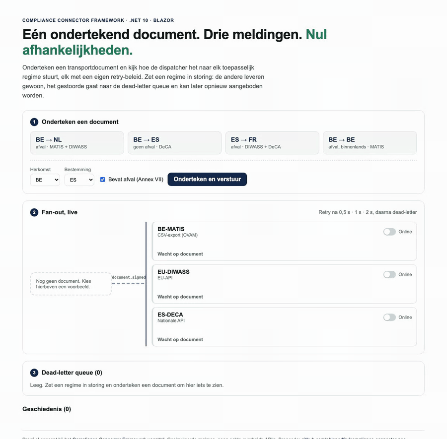
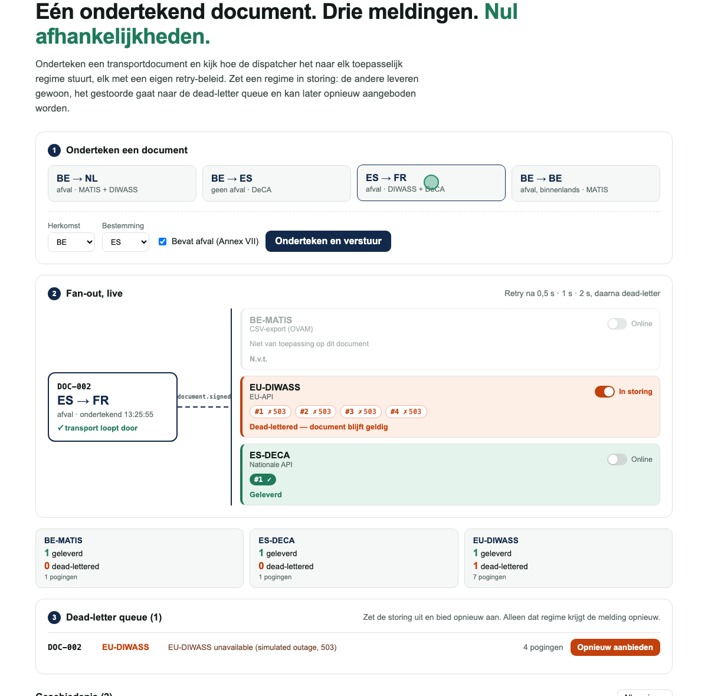
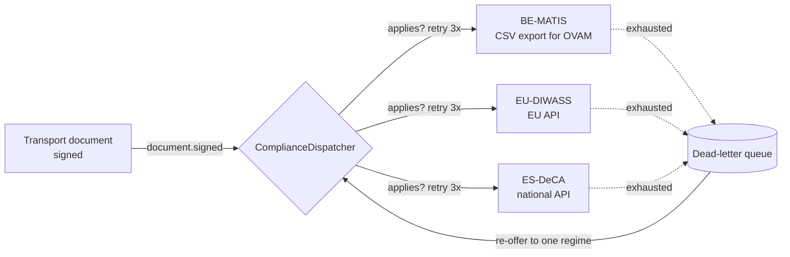

# Compliance Connector Framework — proof of concept

[](https://github.com/phlppgdfry/compliance-connector-poc/actions/workflows/ci.yml)


**One signed transport document → every applicable national or EU compliance regime gets its
own report, with its own retry policy. A failing government API can never block another regime,
or the document itself.**

A small, runnable .NET solution proving out the architecture proposed in the
[Compliance Connector Framework pitch](https://phlppgdfry.github.io/compliance-pitch/).

<p align="center">
  
</p>

## Try it in 30 seconds

```bash
dotnet run --project src/ComplianceConnectors.Dashboard   # http://localhost:5289
```

1. Click **BE → NL**. MATIS and DIWASS both get a report. DIWASS is simulated as an overloaded,
   just-launched API, so you will often see `#1 ✗ 503`, `#2 ✗ 503`, `#3 ✓`: retries, live.
2. Switch **EU-DIWASS** to *In storing* and click **ES → FR**. DeCA delivers on the first attempt;
   DIWASS retries after 0.5 s, 1 s and 2 s, then lands in the **dead-letter queue**. The document
   card still says *transport loopt door*.
3. Switch DIWASS back online and press **Opnieuw aanbieden**. Only DIWASS receives the report
   again; MATIS and DeCA already have theirs, so re-sending to them would create duplicates.



## The idea



A transport document reaches a point in its lifecycle (created, signed, ...) → one
`SignedDocument` event → every applicable regime (`IComplianceReporter`) picks it up
independently. A flaky or newly-launched government API (like DIWASS around its mandatory EU
go-live) can never block another regime or the document itself. Not every regime delivers the
same way, either — `ReportAsync` stands for "handle this regime's reporting", whether that's a
live API call (DIWASS, DeCA) or generating an export file (MATIS, today).

## What's here

| Project | What it proves |
| --- | --- |
| **`ComplianceConnectors.Core`** | The contract (`IComplianceReporter`), the event (`SignedDocument`) and `ComplianceDispatcher`: parallel fan-out, per-regime Polly retry with exponential backoff, failure isolation, an `AttemptEvent` for every single attempt, and `RedeliverAsync` to re-offer a dead letter to one regime. |
| `Reporters/` | `MatisReporter` (Belgium/OVAM — a CSV export submitted by hand, not a live API), `DiwassReporter` (EU, flaky around launch), `DecaReporter` (Spain, mandatory October 2026). A fourth regime is a fourth class; nothing else changes. |
| `Simulation/FaultInjectingReporter` | A decorator that can switch any regime "down" or add latency, without touching the reporter. Used by the dashboard and the tests. |
| **`ComplianceConnectors.Dashboard`** | Blazor Server UI on the same dispatcher: live lanes per regime, outage switches, dead-letter queue with replay, history. State is per browser session. |
| **`ComplianceConnectors.Demo`** | The same story as console output. |
| **`ComplianceConnectors.Tests`** | 19 xUnit tests: applicability per regime, retry, dead-lettering, one regime failing never affecting another, attempt events, targeted redelivery. |

## Run it

```bash
dotnet test                                              # 19 tests
dotnet run --project src/ComplianceConnectors.Demo       # console version
dotnet run --project src/ComplianceConnectors.Dashboard  # Blazor dashboard, http://localhost:5289
```

## Design notes

- **Why per-regime retry instead of one retry around everything?** Retrying the whole dispatch
  would re-send to regimes that already succeeded. Each lane retries only itself.
- **Why does the dashboard marshal with `InvokeAsync`?** Attempt events arrive from parallel
  reporter tasks and Polly's retry timers, not from the Blazor renderer's thread.
- **Why is the dashboard state scoped, not singleton?** So two people opening the demo never see
  each other's documents or outages.

## What this deliberately does not do

This is a proof of concept, not production code: no real Azure Service Bus connection, no real
DIWASS/DeCA/MATIS API calls, no persistence or audit trail. Those are the natural next steps —
the dead-letter queue would become a Service Bus dead-letter sub-queue, the history an
append-only store. This exists to prove the shape of the architecture is sound before spending
real integration time on it.
